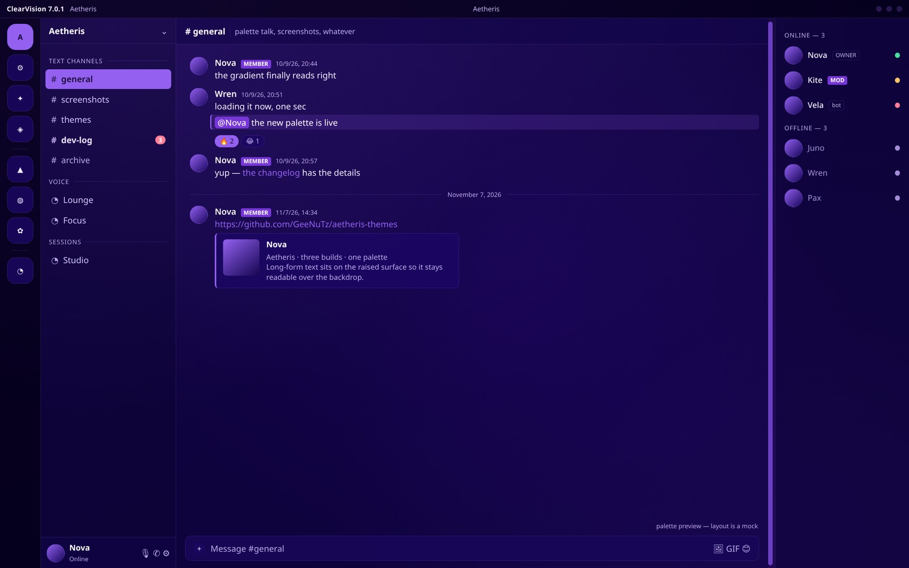
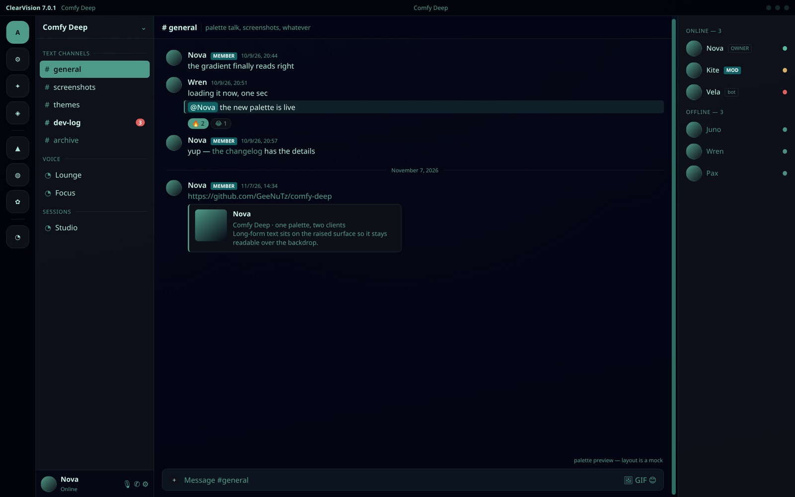

# Discord Themes

**One repository for my Discord themes — desktop (ClearVision v7 for Vesktop/Vencord) and mobile
(Revenge), each theme in its own folder with both release types.**

Every theme is a colour design, not a layout design: ClearVision builds the interface and the
theme supplies colour, canvas and type. Mobile themes reuse the same palette through Revenge's
theme manifest, generated from the desktop stylesheet so the two clients cannot drift.

| Theme | Folder | Desktop | Mobile | Palette |
|---|---|---|---|---|
| **Aetheris** | [`aetheris/`](aetheris/) | 3 builds: Aetheris, Aetheris BG, Aetheris Deep | `Aetheris-Revenge.json` | violet / indigo, AsterionVT's |
| **Comfy Deep** | [`comfy-deep/`](comfy-deep/) | `ComfyDeep.theme.css` | `ComfyDeep-Revenge.json` | teal on near-black navy, from Comfy's `Deep` |




## Layout

```
<theme>/
  <Theme>.theme.css        the shipped desktop theme (ClearVision v7)
  <Theme>-Revenge.json     the shipped mobile theme (Revenge, spec 2)
  src/                     palette + template the two artifacts are generated from
  test/                    the contract: structure, contrast, drift
  tools/                   build / report / preview / verify
  docs/                    generated contrast report, previews, screenshots
  README.md CHANGELOG.md version.json package.json
tools/                     collection-level runner and publish gate
```

Each folder is self-contained: `cd <theme> && npm test` works on its own, and nothing in one theme
imports from another. The root only aggregates.

## Install

| Client | What to copy | Where |
|---|---|---|
| Vesktop / Vencord (Linux) | `<Theme>.theme.css` | `~/.config/Vencord/themes/` |
| Vesktop / Vencord (Windows) | `<Theme>.theme.css` | `%APPDATA%\Vencord\themes` |
| Vesktop (Flatpak) | `<Theme>.theme.css` | `~/.var/app/dev.vencord.Vesktop/config/Vencord/themes/` |
| Revenge (mobile) | `<Theme>-Revenge.json` | Settings → Revenge → Themes → **+** → paste a URL |

Then **Settings → Themes** on desktop and toggle it on. The list entry is the `@name` inside the
file, not the filename — so two files with the same `@name` are indistinguishable.

Revenge only installs from a URL, so a theme has to be reachable before the phone can use it. For a
local test:

```bash
cd comfy-deep && python3 -m http.server 8099
# phone: http://<your-lan-ip>:8099/ComfyDeep-Revenge.json
```

## Every theme is measured

Each theme ships a test suite that recomputes WCAG contrast for every text/surface pair against the
brightest pixel its own background can produce — a gradient is sampled, a wallpaper is bounded by
the theme's own `brightness()` filter. A pair under 4.5:1 fails the build. Reports live in
`<theme>/docs/CONTRAST.md` and are generated, never hand-written.

| Theme | Checks |
|---|---|
| Aetheris | 56 — three builds + mobile manifest |
| Comfy Deep | 23 — stylesheet + mobile manifest |

## Development

```bash
npm test          # every theme's suite
npm run verify    # the publish gate: all suites, artifact drift, versions, secrets, git state
```

Per theme:

```bash
cd comfy-deep
npm run build     # src/ -> the shipped .css and .json
npm test
npm run report    # docs/CONTRAST.md
npm run preview   # docs/preview*.html behind the screenshots
npm run verify    # that theme's artifact gate
```

## Adding a theme

1. Copy the closest existing folder (it already has the template, tests, tools and CI wiring).
2. Replace `src/palettes/<name>.css` with the new palette and `src/variants.json` with its name,
   file name and description.
3. `npm run build`, `npm test`, `npm run report`, `npm run preview`.
4. Add a row to the table above and a folder link.
5. `cd .. && npm test && npm run verify` before committing.

## Credits

| Whose work | What |
|---|---|
| **AsterionVT** | The Aetheris palette and the original 4.0.0 theme (kept verbatim in `aetheris/docs/legacy/`). |
| **Comfy Themes** | The `Deep` colourscheme from [Comfy for Spicetify](https://github.com/Comfy-Themes/Spicetify). The Comfy Deep port is their design, not mine. |
| **ClearVision Team** | ClearVision v7, imported by every desktop theme at runtime. Not vendored. |
| **Quinxxxx** | The Meloso typeface used by Aetheris. |
| **Revenge** | The mobile client and its theme format, which this repo targets. |

## License

MIT for this collection's own code and docs — see [LICENSE](LICENSE). Palettes belong to their
authors (see Credits); ClearVision v7 and any bundled wallpaper belong to the ClearVision Team.
Nothing third-party is redistributed here.
