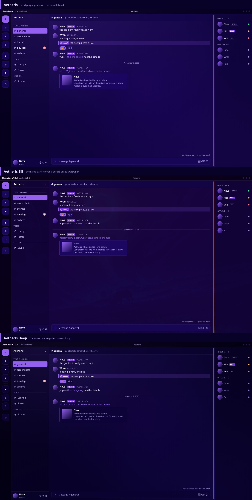
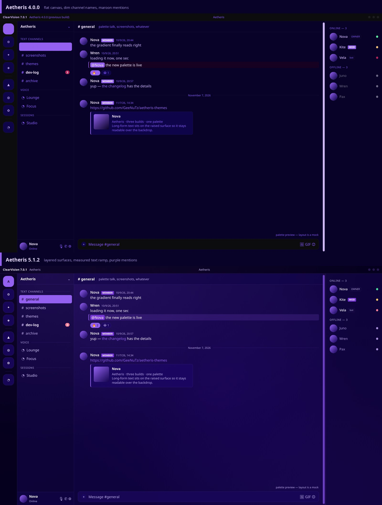

# Aetheris

**A deep-purple ClearVision v7 theme for Vencord / Vesktop, in three builds — AsterionVT's
Aetheris palette, with text you can actually read.**

Aetheris is a colour theme, not a layout theme: ClearVision builds the interface, these files
supply every colour, gradient and typeface. The interesting part is not the hues — those are the
original author's — but that each one now sits on a measured contrast pair instead of a guess.



## The three builds

Every build is a standalone stylesheet. Install one, or all three; each has its own `@name`, so
the theme list shows them side by side instead of as duplicates.

| File | Listed as | Look | Pick it when |
|---|---|---|---|
| `Aetheris.theme.css` | **Aetheris** | vivid purple gradient, brightest surfaces | you want the palette at full strength |
| `Aetheris-BG.theme.css` | **Aetheris BG** | the same palette over a purple-tinted wallpaper | you want a picture behind it |
| `Aetheris-Deep.theme.css` | **Aetheris Deep** | the same palette pulled toward indigo | you want it dark on an OLED |

| Screenshot | Shows |
|---|---|
| [aetheris.jpg](docs/screenshots/aetheris.jpg) | Aetheris |
| [aetheris-bg.jpg](docs/screenshots/aetheris-bg.jpg) | Aetheris BG |
| [aetheris-deep.jpg](docs/screenshots/aetheris-deep.jpg) | Aetheris Deep |
| [themes-menu.jpg](docs/screenshots/themes-menu.jpg) | the three `@name` entries as Vencord lists them |

The images are rendered headless from the shipped palettes (`docs/preview*.html`), with neutral
server, channel and member names. The layout is a mock of Discord's window, so the pictures show
colour and density, not Discord's real DOM — the selector fixes are verified statically instead.

> The `@name` inside the file is what Vencord lists — **not the filename**. Files that differ only
> by filename but carry the same `@name` cannot be told apart in the list. That is what happened to
> the three byte-identical copies of the 4.0.0 build, and why these three builds are named apart.

Before / after against 4.0.0:



## What this theme does

- Sets ClearVision's own settings (`--main-color`, `--channel-*`, `--background-*`) so the
  framework, not the theme, keeps working — no patched ClearVision file to maintain.
- Replaces the flat `#080228` canvas with a bounded purple gradient and five translucent surface
  steps, so the rails, sidebar, chat and composer read as separate planes.
- Runs a measured text ramp: every pair is checked against the brightest pixel its backdrop can
  produce, and `npm test` fails if a pair drops below WCAG AA.
- Restores meaning to the semantic colours — danger is rose, success is mint, warning is amber —
  instead of painting them purple like the previous build did.
- Keeps the saturated accent where it belongs (pills, rings, focus) and uses a darker fill
  wherever white text has to sit on it.
- Maps Discord's full `--brand-*` / `--primary-*` ramps, including the literal alpha variants,
  which is where stray blurple controls come from.
- Matches both `name_hash` and `name-hash` class conventions, so a Discord class rename disables
  one rule instead of painting the wrong colour.

## What was done (the short version)

**4.0.0**, the starting point, recoloured ClearVision through opaque `!important` variables: every
panel became the same `#080228`, the composer was near-black, mentions were maroon, danger was
purple (`--red-400` remapped to `#7150eb`), `--channel-selected` was set to the same colour as the
pill behind it, and channel/member text sat at 3–4:1. **4.2.0** ("BG") tried to fix the flatness
the other way, by making the panels transparent over a tinted wallpaper — which drained the colour
out instead.

**5.0.0** rebuilt the palette around measured contrast, but pushed the hue toward indigo, which
read as "less purple". **5.1.x** keeps the measurement and restores the saturation: vivid surfaces
(`rgba(18, 5, 72, 0.62)`), a brighter lavender text ramp (`#f0e6ff` / `#bda6ea`), and three
separately named builds generated from one template so they cannot drift.

| Change | Before | Now |
|---|---|---|
| Canvas | one flat `#080228` | bounded violet gradient + five surface steps |
| Text ramp | `#cbadff` on `#080228`, muted `#8957ff` | `#f0e6ff` body, `#bda6ea` muted, all measured |
| Danger | `#b52258` text, `#7150eb` "red" | `#ff7f96` text, `#c73e60` fill |
| Mentions | maroon `rgba(114, 0, 0, .15)` | purple wash + accent rail |
| Selected channel | label colour = pill colour | dark label on the bright pill |
| Composer | `#0c0c0e` near-black | raised purple step with an accent rim |
| Wallpaper build | panels transparent → colour drained | purple wash + `brightness(0.55)` cap, panels opaque |
| Force | `!important` everywhere | zero `!important`, won by order and specificity |

All numbers, per build, are generated into [docs/CONTRAST.md](docs/CONTRAST.md).

## Install

Copy **one or more** of the three `.css` files into the client's themes folder.

| Platform | Themes folder |
|---|---|
| Windows (Vesktop / Vencord) | `%APPDATA%\Vencord\themes` |
| Linux | `~/.config/Vencord/themes` |
| Vesktop as a Flatpak | `~/.var/app/dev.vencord.Vesktop/config/Vencord/themes` |

```bash
# Linux example
mkdir -p ~/.config/Vencord/themes
cp Aetheris.theme.css Aetheris-BG.theme.css Aetheris-Deep.theme.css ~/.config/Vencord/themes/
```

Then **Settings → Themes** and toggle on the ones you want (Vesktop: Settings → Vencord → Themes).

Gotchas:

- These files **import ClearVision v7 from clearvision.github.io**. If that host is unreachable the
  layout never arrives and you get a recoloured stock Discord, not an error.
- They are **dark-theme only**. Switching Discord to Light leaves the light theme unstyled on
  purpose rather than half-styled.
- **Aetheris BG** fetches its wallpaper from the same host. Without network the wash and panels
  still render, so it degrades to a purple gradient.
- Renaming a file does not rename the theme. Edit `@name` to change the list entry.

To go flat (no gradient, exactly the original `#080228` canvas), set `--background-image: none;` in
the ClearVision settings block.

## Using it

| Area | What you do |
|---|---|
| Colours | Edit `--aether-*` tokens in section 1 of a palette file, then `npm run build`. |
| Accent | `--main-color` is decoration; `--aether-accent-fill` is the one white text sits on. |
| Gradient | `--background-image` in the ClearVision settings block; `none` for flat. |
| Wallpaper | Same variable; keep the purple wash layer in front of the `url()` or text contrast is no longer bounded. |
| Fonts | `--main-font` (body) and `--font-display` (titles, usernames). |
| Opacity | Surface tokens carry their own alpha; lower it for more glow, raise it for more solid. |

## Palette

| Role | Token | Vivid | BG | Deep |
|---|---|---|---|---|
| Canvas | `--aether-base` | `rgba(18, 5, 72, .62)` | `.78` | `rgba(10, 3, 46, .64)` |
| Sidebar | `--aether-sidebar` | `rgba(14, 4, 60, .72)` | `.84` | `rgba(7, 1, 32, .74)` |
| Rail | `--aether-tertiary` | `rgba(5, 0, 26, .84)` | `.9` | `rgba(4, 0, 16, .84)` |
| Raised | `--aether-raised` | `rgba(28, 8, 100, .8)` | `.88` | `rgba(14, 4, 56, .82)` |
| Accent | `--aether-accent` | `#9360f0` | `#9360f0` | `#9360f0` |
| Accent fill | `--aether-accent-fill` | `#7636d8` | `#7636d8` | `#7636d8` |
| Text | `--aether-text` | `#f0e6ff` | `#f0e6ff` | `#e9dcff` |
| Muted | `--aether-text-muted` | `#bda6ea` | `#bda6ea` | `#a08cd4` |
| Danger | `--aether-danger` | `#ff7f96` | `#ff7f96` | `#ff7a94` |
| Success | `--aether-success` | `#4ade9e` | `#4ade9e` | `#4ade9e` |
| Warning | `--aether-warning` | `#f9c46b` | `#f9c46b` | `#f9c46b` |

## Meaning of numbers

| Metric | How it is computed |
|---|---|
| Contrast ratio | WCAG 2.1: `(L1 + 0.05) / (L2 + 0.05)` on linearised sRGB luminance. |
| Brightest backdrop pixel | Gradient builds: `--background-image` sampled on a 97×97 grid over four viewports, maximum-luminance composite. Aetheris `#462782`, Deep `#3c2579`. |
| Brightest backdrop pixel, BG | A bitmap cannot be read, so it is modelled as pure white through the build's own `brightness(0.55)`, then the purple wash composited on top: `#393251`. |
| Text on a surface | The surface is composited over that peak, text is composited if translucent, and the worse of "over the backdrop" and "over the `#080228` fallback" is used. |
| Floors | 4.5 normal text, 7.0 main reading surfaces, 3.0 large text and UI boundaries. |

## Data & privacy

Nothing is collected and no state is written. The files only reference what the client fetches:

| Outbound request | When | Why |
|---|---|---|
| `clearvision.github.io/ClearVision-v7/main.css` | client start | the framework these builds colour |
| `clearvision.github.io/ClearVision-v7/vencord.css` | client start | Vencord-specific fixes from ClearVision |
| `clearvision.github.io/images/sapphire.jpg` | `Aetheris BG` only, client start | the wallpaper |
| `github.com/Quinxxxx/Meloso/...` (2 files) | first render of a title | Aetheris display font |
| `github.com/VodkaXMartini/.../Roboto-Regular.ttf` | client start | Aetheris body font |

All are plain static GETs; none carries a token, query string or identifier beyond what any HTTP
request reveals. To drop the fonts, delete the three `@font-face` blocks — the stacks fall back to
`gg sans` and Consolas.

The screenshots contain no third-party data: names, channels and messages are invented, and the
pages that produce them are in `docs/preview*.html`. Earlier revisions of this repository used live
captures with other users' display names; they are replaced, and remain only in git history.

## Development

```bash
cd aetheris
npm run build       # src/theme.template.css + src/palettes/*.css -> three stylesheets + the manifest
npm test            # 65 checks: three builds + three manifests
npm run report      # regenerates docs/CONTRAST.md for all builds
npm run preview     # regenerates docs/preview*.html from the shipped files
```

The shipped `.css` files are generated and committed: a client needs one standalone file, so there
is no runtime import and no build step at install time. `npm test` fails if a shipped file no longer
matches what `npm run build` would produce.

| Path | What it is |
|---|---|
| `src/theme.template.css` | everything the builds share: fonts, surfaces, text, ramps, status, borders, component fixes |
| `src/palettes/aetheris.css` | vivid palette (tokens + ClearVision settings + gradient) |
| `src/palettes/aetheris-bg.css` | the same palette, higher alpha, wallpaper + wash + filter |
| `src/palettes/aetheris-deep.css` | the indigo palette |
| `src/variants.json` | file, `@name`, description and palette per build |
| `test/` | the contract, dependency-free |
| `tools/` | `build.mjs`, `report.mjs`, `preview.mjs` |
| `docs/legacy/Aetheris-4.0.0.css` | the previous build, verbatim, for diffing |
| `tools/build-revenge.mjs` | renders one `-Revenge.json` per build from the shipped stylesheets |

| Suite | Checks |
|---|---|
| `test/theme.test.js` | per build: metadata, structure, `@import` order, no `!important`, no duplicate declarations, every `var()` resolves, ClearVision contract complete, backdrop bound, surfaces translucent and stepping downward, all 27 text pairs at AA, legacy failing values gone, both class-name conventions, display font. Plus build drift, unique names, distinct palettes |
| `test/color.js` | WCAG luminance, contrast, source-over compositing |
| `test/css.js` | stylesheet walk, custom-property collection, `var()` resolution with cycle detection |
| `test/gradient.js` | evaluates the real backdrop declaration (gradient layers, wallpaper as white-through-filter) to its brightest pixel; throws on grammar it does not understand instead of returning a wrong bound |
| `test/palette.js` | resolves a build into colours composited over the measured backdrop |
| `test/spec.js` | the contract: pairs and floors, legacy values, required ClearVision settings |

Selector fixes are verified statically against ClearVision 7.0.1's published CSS, not against a
running client; the screenshots are the live check.

## Credits

| Whose work | What |
|---|---|
| **AsterionVT** | The Aetheris palette and the original `Aetheris x ClearVision` 4.0.0 theme, kept verbatim in `docs/legacy/`. This repo would not exist without it. |
| **ClearVision Team** | ClearVision v7 (`clearvision.github.io`), the layout framework every build imports. Not vendored — the files reference it at runtime. |
| **Quinxxxx** | The Meloso typeface used for titles. |
| **Roboto** (Christian Robertson / Google) | Body typeface, referenced through VodkaXMartini's mirror (Apache-2.0). |
| **GeeNuTz** | The 5.x rewrite: layered surfaces, measured text ramp, three builds, test harness, docs. |

The 4.x builds were "made with AI" in the author's own words; the 5.x work here was also
AI-assisted, reviewed and verified by the tests and screenshots above. If you reuse this, keep the
palette credit to AsterionVT and the framework credit to ClearVision.

## Versioning

`5.3.0` ships the three builds plus one mobile manifest each, and is the base. `5.0.0` was the single-build rewrite (now
`Aetheris Deep`'s palette); `4.0.0` is kept verbatim in
[docs/legacy/Aetheris-4.0.0.css](docs/legacy/Aetheris-4.0.0.css).

## Mobile (Revenge)

Each build has its own manifest, generated from that build's stylesheet so the two clients cannot
drift. Revenge installs one theme at a time, so this is three separate installs:

| Desktop build | Mobile manifest |
|---|---|
| `Aetheris.theme.css` | `Aetheris-Revenge.json` |
| `Aetheris-BG.theme.css` | `Aetheris-BG-Revenge.json` |
| `Aetheris-Deep.theme.css` | `Aetheris-Deep-Revenge.json` |

They appear in Revenge as **Aetheris**, **Aetheris BG** and **Aetheris Deep** — the `name` field
inside each file, same as on desktop.

Revenge installs from a URL, so serve them from your machine first:

```bash
cd ..                 # collection root
npm run serve         # prints http://<lan-ip>:8099/ and every JSON URL
```

Open that address on the phone, tap the manifest you want, copy the link, paste it into
**Revenge → Themes → +**. Nothing is published; the server is LAN-only and read-only.

## Changelog

See [CHANGELOG.md](CHANGELOG.md).

## License

MIT — see [../../LICENSE](../../LICENSE), which covers this collection's own code and docs. The
Aetheris palette is AsterionVT's; ClearVision v7 belongs to the ClearVision Team; Meloso and Roboto
belong to their authors. Nothing third-party is redistributed here.
