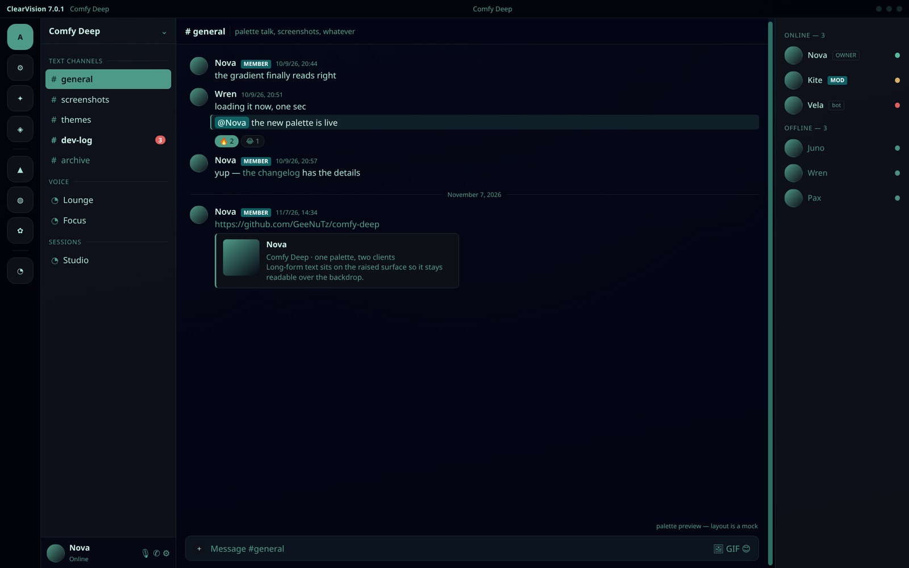
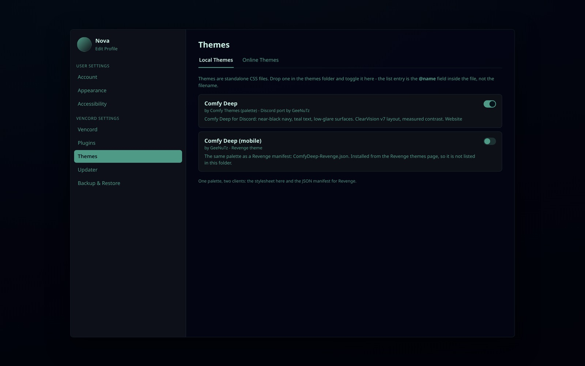

# Comfy Deep for Discord

**The Comfy `Deep` colourscheme from Spicetify, ported to Discord — one palette, two clients: a
ClearVision v7 theme for Vesktop/Vencord and a Revenge theme for mobile.**



## What it is

Comfy is a Spicetify theme for Spotify; its `Deep` colourscheme is a near-black navy with muted
teal text (`#4F9A87` on `#040614`). This repo carries that palette to Discord without changing its
character: same canvas, same sidebar and card values, same teal, same ember-red error colour.

Two artifacts, generated from one palette:

| File | Client | What it is |
|---|---|---|
| `ComfyDeep.theme.css` | Vesktop / Vencord (Linux, Windows, macOS) | a ClearVision v7 theme: the framework builds the layout, this file supplies every colour |
| `ComfyDeep-Revenge.json` | Revenge (Android/iOS) | a `spec: 2` theme manifest (semantic + raw colour maps) |

What was added on top of a straight colour swap:

- **A measured text ramp.** Comfy paints body text at `#4F9A87`; on a chat app that is the *muted*
  step. Body text is lifted to `#A8E3D3` (14:1) while `#4F9A87` stays for timestamps and muted
  channels (5.7:1 on the sidebar).
- **Layered surfaces.** Canvas, sidebar, cards and popouts use the palette's own four steps with
  alpha, over one faint teal glow, instead of a single flat `#040614`.
- **Accent split.** `#106165` (Comfy's button) carries white labels; `#4F9A87` (Comfy's
  selected-row) is the bright pill, with dark ink on it — so the selected channel reads at 5.7:1
  instead of the 3.3:1 you get from white on teal.
- **Semantic colours** that survive on a dark teal canvas: danger `#E05F5F`, success `#58B79B`,
  warning `#D8B26A`, each with a darker fill for buttons.
- **No webfont.** Discord's own `gg sans` — nothing extra leaves the client for type.

## Install

### Vesktop / Vencord (desktop)

| Platform | Themes folder |
|---|---|
| Linux | `~/.config/Vencord/themes` |
| Vesktop as a Flatpak | `~/.var/app/dev.vencord.Vesktop/config/Vencord/themes` |
| Windows | `%APPDATA%\Vencord\themes` |

```bash
mkdir -p ~/.config/Vencord/themes
cp ComfyDeep.theme.css ~/.config/Vencord/themes/
```

Then **Settings → Themes → Comfy Deep**.



The file imports ClearVision v7 from `clearvision.github.io`; without that host you get a
recoloured stock Discord rather than an error. Dark theme only, on purpose.

### Revenge (mobile)

Revenge installs themes from a URL (raw file), not from the desktop themes folder. Once this repo
is published:

```
Settings → Revenge → Themes → + → paste the raw URL of ComfyDeep-Revenge.json
```

To try it before publishing, serve the file from your own machine and point Revenge at it:

```bash
python3 -m http.server 8099        # from the repo root
# then, on the phone, use http://<your-lan-ip>:8099/ComfyDeep-Revenge.json
```

The manifest sets `spec: 2` (the Vendetta format Revenge still parses), with both `semanticColors`
and `rawColors` filled, so covered surfaces and uncovered ones land in the same family. Mobile
coverage is partial by design: Discord's mobile app uses a smaller token set than desktop, and any
surface that reads neither map keeps its default colour.

## Using it

| Area | What you do |
|---|---|
| Colours | Edit the tokens in `src/palettes/comfy-deep.css`, then `npm run build`. |
| Canvas | `--background-image`: three layers; set it to `none` for Comfy's literal flat `#040614`. |
| Accent | `--main-color` is decoration; `--comfy-accent-fill` is what white text sits on. |
| Mobile | The JSON is generated from the same palette — change the CSS side, rebuild, both move. |
| Text size | Nothing here changes font size; only colour and the display stack. |

## Palette

Sampled from `Comfy/color.ini` → `[Deep]` in
[Comfy-Themes/Spicetify](https://github.com/Comfy-Themes/Spicetify):

| Role | Comfy `Deep` | Here |
|---|---|---|
| Canvas (`main`) | `#040614` | `rgba(4, 6, 20, 0.88)` over the glow |
| Sidebar | `#0F111A` | `rgba(15, 17, 26, 0.92)` |
| Card | `#0F1118` | `rgba(15, 17, 24, 0.95)` |
| Elevated | `#0A111D` | `rgba(10, 17, 29, 0.97)` |
| Highlight | `#0F1F28` | hover/selection alphas |
| Text | `#4F9A87` | `#A8E3D3` body, `#4F9A87` muted |
| Button | `#106165` | `--comfy-accent-fill` |
| Selected row | `#4F9A87` | selected pill + dark ink |
| Error | `#D25050` | `#E05F5F` text, `#8E2F2F` fill |

Every value, composited, plus all 27 measured pairs: [docs/CONTRAST.md](docs/CONTRAST.md).

## Meaning of numbers

| Metric | How it is computed |
|---|---|
| Contrast ratio | WCAG 2.1: `(L1 + 0.05) / (L2 + 0.05)` on linearised sRGB luminance. |
| Brightest backdrop pixel | `--background-image` sampled on a 97×97 grid over four viewports; the maximum-luminance composite. Currently `#0A1D2B` (luminance 0.011). |
| Text on a surface | Surface composited over that peak (worse case for light text), text composited if translucent. |
| Floors | 4.5 normal text, 7.0 main reading surfaces, 3.0 large text and UI boundaries. |
| Mobile values | The manifest cannot paint a gradient, so each surface is flattened to an opaque hex over that same peak. |

## Data & privacy

Nothing is collected, nothing is written. The only outbound requests are the ones the files
reference:

| Outbound request | When | Why |
|---|---|---|
| `clearvision.github.io/ClearVision-v7/main.css` | client start | the layout framework |
| `clearvision.github.io/ClearVision-v7/vencord.css` | client start | Vencord-specific fixes from ClearVision |
| *(Revenge)* none | — | the manifest is self-contained |

No webfonts, no wallpaper, no analytics. Screenshots in this repo are rendered from the palette with
invented names; no real chat, no third-party handles.

## Development

```bash
cd repo
npm run build     # src/ -> ComfyDeep.theme.css + ComfyDeep-Revenge.json
npm test          # 23 checks across both artifacts
npm run report    # docs/CONTRAST.md
npm run preview   # docs/preview*.html (the mock layouts behind the screenshots)
npm run verify    # the pre-publish gate: tests, versions, drift, secrets, git state
```

| Path | What it is |
|---|---|
| `src/theme.template.css` | the ClearVision mapping shared by any palette |
| `src/palettes/comfy-deep.css` | the palette: tokens + ClearVision settings + canvas |
| `src/variants.json` | file name, `@name`, description, surface order |
| `tools/build.mjs` | renders the stylesheet |
| `tools/build-revenge.mjs` | renders the mobile manifest from the same palette |
| `tools/verify.mjs` | the gate that must pass before a push |
| `test/` | the contract, dependency-free |

| Suite | Checks |
|---|---|
| `test/theme.test.js` | build drift, metadata, structure, `@import` order, no `!important`, `var()` resolution, ClearVision contract, canvas bound, surface order, 27 contrast pairs, foreign-palette guard, filled buttons, both class conventions, manifest schema, manifest↔stylesheet palette equality, manifest readability |
| `test/color.js`, `test/css.js`, `test/gradient.js`, `test/palette.js`, `test/spec.js` | WCAG math, stylesheet parsing, gradient sampling, palette resolution, the contract |

Selector fixes are verified statically against ClearVision 7.0.1's published CSS. The screenshots
are renders of `docs/preview*.html`, so they show colour and density, not Discord's real DOM.

## Versioning

`1.0.0` is the first release and the base. `package.json`, `version.json` and the stylesheet header
move together — `npm run verify` fails if they diverge.

## Credits

| Whose work | What |
|---|---|
| **Comfy Themes** | The `Deep` colourscheme and the whole visual idea, from [Comfy for Spicetify](https://github.com/Comfy-Themes/Spicetify). This is a port of their palette, not an original design. |
| **ClearVision Team** | ClearVision v7, the layout framework the stylesheet imports. Not vendored. |
| **GeeNuTz** | The Discord port: mapping, text ramp, contrast harness, Revenge manifest, docs. |

If you reuse this, keep the Comfy credit — the colours are theirs.

## License

MIT for this repo's own code and docs ([LICENSE](LICENSE)). The Comfy palette belongs to the Comfy
Themes authors; ClearVision v7 belongs to the ClearVision Team. Neither is redistributed here.

## Changelog

See [CHANGELOG.md](CHANGELOG.md).
